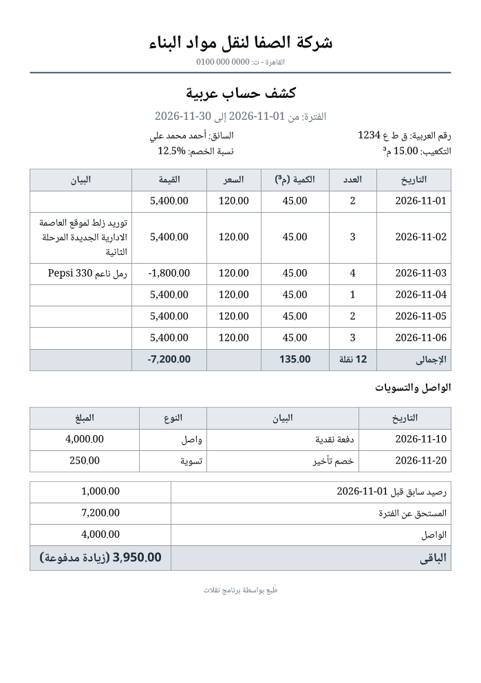
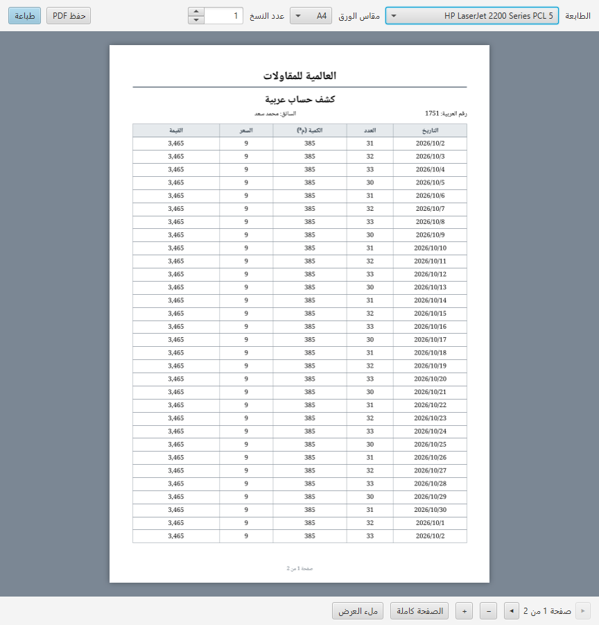

<div dir="rtl">

# Smart Report Plugin

       

[English](README.md) | **العربية**

مكتبة جافا للتقارير والطباعة، بتضاف كـ dependency لأي مشروع:

- **مستندات PDF عربية جاهزة للطباعة** على A4 و A5 (طولي وعرضي): ترويسة، عنوان، بيانات، أكتر من جدول بصف إجمالي، ملخص، ترقيم صفحات، رمز QR، باركود — وإرسال مباشر للطابعة. عبر Apache PDFBox (و ZXing core لتشفير رمز QR والباركود).
- **نافذة معاينة JavaFX** جاهزة: الصفحات كما هتتطبع، اختيار الطابعة والمقاس وعدد النسخ، طباعة وحفظ PDF — أو طباعة على طول على آخر طابعة اتختارت، من غير نافذة.
- **PDF أو Excel عام من `List<POJO>`** بدون أي قالب.
- **JasperReports** (قوالب `.jrxml`/`.jasper` مصممة بصريًا): تصدير PDF, XLSX, HTML, أو CSV.

<p align="center"></p>

## ما الجديد

### 2.10.0

- **جديد:** علامة مائية على كل صفحة (`watermark`)، مثل «صورة» على نسخة الفاتورة أو «ملغاة»، وهي شفافة فيبقى ما تحتها مقروءًا. التفاصيل في [العلامة المائية](#العلامة-المائية-watermark).
- **جديد:** إجمالي فرعي لكل مجموعة في تقرير PDF وExcel العام (`groupBy`)، لكشف حساب مقسَّم حسب العميل أو الشهر. التفاصيل في [الإجمالي الفرعي لكل مجموعة](#الإجمالي-الفرعي-لكل-مجموعة).

### 2.9.1

- **إصلاح:** لم يعد تقرير Excel العام يفشل إذا بدأ عنوانه بفاصلة عليا أو انتهى بها، مثل `'Q1' sales`. التفاصيل في [PDF أو Excel عام](#pdf-أو-excel-عام-بدون-قالب).
- **تغيير:** أُعيدت كتابة تخطيط صفحات PDF داخليًا لتخضع أجزاء المستند كلها لقواعد الصفحات نفسها، ويخرج المستند كما كان تمامًا.

### 2.9.0

- **جديد:** `pageBreak()` يبدأ الجزء التالي في صفحة جديدة، ولا يترك صفحة فارغة أبدًا. التفاصيل في [فاصل الصفحات](#فاصل-الصفحات-pagebreak).
- **جديد:** عدة مستندات في ملف PDF واحد ومهمة طباعة واحدة، ولكل مستند ترقيم صفحاته (`PdfBatch`)، مع معاينة للدفعة. التفاصيل في [مستندات في ملف واحد](#مستندات-كتير-في-ملف-واحد-ومهمة-طباعة-واحدة-pdfbatch).
- **جديد:** خط خاص بمستند واحد (`PdfDocument.font`)، و `failOnMissingGlyphs(true)` لإيقاف المستند برسالة خطأ بدلًا من طباعة `?`. التفاصيل في [الخط](#الخط).
- **إصلاح:** لم تعد الرموز `²` و `³` و `½` و `±` تُطبع `?` على جهاز ليس فيه Arial أو DejaVu، ولم تعد المحارف الخفية، مثل التي تلي `©`، تُطبع `?`. التفاصيل في [الخط](#الخط).
- **تغيير:** تُطبع نسخ المستند ذي الصفحات المتعددة مرتّبةً، نسخةً كاملة بعد أخرى.

تفاصيل كل إصدار في [CHANGELOG.md](CHANGELOG.md).

## الوحدات

كل نوع في وحدة Maven لوحده، فالبرنامج اللي بيطبع PDF بس ما يشيلش POI ولا Jasper:

| الوحدة | فيها إيه | بتجيب معاها |
|---|---|---|
| `smart-report-pdf` | `PdfDocument`، `PdfBatch`، `PdfPrinter`، `PdfPages`، وتقرير PDF العام | PDFBox، و ZXing core (رمز QR والباركود) |
| `smart-report-fx` | `PdfPreview`: نافذة المعاينة | `smart-report-pdf`؛ و JavaFX بتاع برنامجك (`provided`) |
| `smart-report-excel` | تقرير Excel العام | Apache POI |
| `smart-report-jasper` | تقارير قوالب Jasper | JasperReports |
| `smart-report-api` | `ReportService` و`ReportRequest` و`AmountInWords` و`ZatcaQr` — بتيجي لوحدها مع أي وحدة فوق | slf4j-api فقط |

## التثبيت

المكتبة بتتسحب من [JitPack](https://jitpack.io) مباشرة من tags المستودع:

<div dir="ltr">

```xml
<repositories>
    <repository>
        <id>jitpack.io</id>
        <url>https://jitpack.io</url>
    </repository>
</repositories>

<dependency>
    <groupId>com.github.MohamedSalah-13.smart-report-plugin</groupId>
    <artifactId>smart-report-pdf</artifactId>
    <version>v2.10.0</version>
</dependency>
```

</div>

غيّر `artifactId` لـ `smart-report-fx` أو `smart-report-excel` أو `smart-report-jasper` حسب اللي محتاجه.
مبنية بـ Java 21. وحدة `smart-report-fx` موجودة من `v2.1.0`.

> المكتبة بتستخدم `slf4j-api` فقط (بدون implementation)، فلو عايز تشوف الـ logs ضيف backend من اختيارك
> (logback, slf4j-simple, ...) في مشروعك.

## مستند PDF (`PdfDocument`)

المستند بيتبني جزءًا بعد جزء بالترتيب اللي هيظهر بيه:

<div dir="ltr">

```java
import com.smart.report.pdf.*;

PdfDocument document = PdfDocument.rtl(Paper.A5)            // أو Paper.A4، أو Paper.A4.landscape()
        .letterhead("شركة الصفا لنقل مواد البناء", "القاهرة - ت: 0100 000 0000")
        .title("كشف حساب عربية")
        .subtitle("الفترة: من 2026-11-01 إلى 2026-11-30")
        .field("رقم العربية", "ق ط ع 1234").field("السائق", "أحمد محمد علي")
        .table(t -> t
                .column("التاريخ", 22).column("العدد", 14, Align.CENTER).column("القيمة", 26, Align.CENTER)
                .rows(movements, m -> new String[]{date(m), trips(m), amount(m)})
                .totals("الإجمالى", "12 نقلة", "-7,200.00"))
        .heading("الواصل والتسويات")
        .table(payments)
        .summary("المستحق عن الفترة", "7,200.00")
        .summary("الواصل", "4,000.00")
        .summaryTotal("الباقى", "3,200.00")
        .footer("شكرًا لتعاملكم")
        .signatures("المستلم", "المحاسب", "الختم");          // خانات توقيع، بتفضل مع الملخص اللي فوقها

document.save(Path.of("statement.pdf"));     // ملف
byte[] pdf = document.toBytes();             // أو بايتات
```

</div>

- `PdfDocument.rtl(...)` للعربي و`PdfDocument.ltr(...)` للإنجليزي. الاتجاه بيحدد مكان أول عمود ومحاذاة النص.
- الأعمدة والخلايا بتتكتب **بالترتيب المنطقي**؛ المكتبة هي اللي بتحط أول عمود على اليمين في الصفحة العربية.
- رقم العمود (22، 14، 26) وزنه من عرض الجدول، ومفيش عمود بينزل عن عرض أطول كلمة فيه.
- النص الأطول من عموده **بيلتف** على أكتر من سطر، ورأس الجدول بيتكرر في كل صفحة، والصفحات بتترقّم ("صفحة 2 من 3") لما المستند يبقى أكتر من صفحة.
- الصف الأطول من صفحة كاملة بيكمل على الصفحة اللي بعدها، وكذلك البيان اللي قيمته أطول من صفحة. ورأس الجدول
  الأطول من تلت الصفحة بيترسم مرة واحدة بدل ما يتكرر في كل صفحة.
- الأرقام السالبة، التواريخ، النسب، وأرقام التليفون بتتقرا زي ما اتكتبت جوّه الجملة العربية.

### التفقيط (`AmountInWords`)

الإجمالي مكتوبًا بالحروف، زي ما بيتكتب في الفاتورة أو الإيصال:

<div dir="ltr">

```java
import com.smart.report.util.AmountInWords;

document.text(AmountInWords.arabic(new BigDecimal("7200"), AmountInWords.Currency.EGP));
// فقط سبعة آلاف ومائتا جنيه لا غير

AmountInWords.arabic(new BigDecimal("1234.50"), AmountInWords.Currency.EGP);
// فقط ألف ومائتان وأربعة وثلاثون جنيهًا وخمسون قرشًا لا غير
AmountInWords.arabicWords(new BigDecimal("0.13"), AmountInWords.Currency.SAR);   // من غير «فقط ... لا غير»
// ثلاث عشرة هللةً

// بالإنجليزي، للفاتورة اللي بلغتين:
AmountInWords.english(new BigDecimal("7200"), AmountInWords.EnglishCurrency.EGP);
// Seven thousand two hundred Egyptian pounds only
AmountInWords.english(new BigDecimal("7200.50"), AmountInWords.EnglishCurrency.EGP);
// Seven thousand two hundred Egyptian pounds and fifty piastres only
```

</div>

- المعدود بيتبع العدد: `جنيه واحد`، `جنيهان`، `ثلاثة جنيهات`، `أحد عشر جنيهًا`، `مائة جنيه`، `مائتا جنيه`، `ألفا جنيه`.
- العدد بيوافق جنس المعدود: `ثلاثة جنيهات` لكن `ثلاث هللات`، والبيسة العمانية مؤنثة كمان: `ثلاث بيسات`،
  `إحدى عشرة بيسةً`.
- عملات جاهزة: `EGP` و`SAR` و`AED` و`KWD` و`USD` و`QAR` و`BHD` و`OMR` و`JOD`، ومن v2.11.0 `SDG` و`GBP` و`YER`
  و`MAD` و`IQD` و`LYD` و`TND` و`DZD` و`SYP` و`LBP` و`TRY` و`EUR`. خانات الكسر زي ISO 4217: 3 للدينار الكويتي
  والبحريني والأردني والعراقي والليبي والتونسي والريال العماني، و2 للباقي. والليرة مؤنثة: `ثلاث ليرات`،
  `إحدى عشرة ليرةً`. وأي عملة تانية `new Currency(...)` بصيغ اسمها.
- بالكود (v2.11.0): `Currency.forCode("EGP")` و`EnglishCurrency.forCode("EGP")` بيرجعوا `Optional`، فاضي للكود
  اللي مش معروف، فالبرنامج ما يطبعش سطر غلط.
- بالإنجليزي: `english(...)` (بـ «only») و`englishWords(...)` بياخدوا `EnglishCurrency` بنفس الأكواد. الأعداد
  مكتوبة زي الفواتير والشيكات (`two hundred fifty`، `thirty-four`)، و«and» قبل الكسر بس. وأي عملة تانية
  `new EnglishCurrency("Libyan dinar", "Libyan dinars", "dirham", "dirhams", 3)`.
- المبلغ بيتقرّب لخانات العملة (النص لفوق)، واللي من ألف مليار وأكتر بيترفض. والسالب بيترفض كمان، إلا مع
  `Negative` (v2.11.0): حروف القيمة المطلقة، وكلمتك قبل النص كله أو بعده.

<div dir="ltr">

```java
AmountInWords.arabic(new BigDecimal("-150"), AmountInWords.Currency.EGP, AmountInWords.Negative.suffix("(دائن)"));
// فقط مائة وخمسون جنيهًا لا غير (دائن)
```

</div>

- موجود في `smart-report-api`، فتقارير Jasper و Excel تقدر تستخدمه كمان (كـ parameter مثلًا).

### في كل صفحة

<div dir="ltr">

```java
document.letterheadOnEveryPage(true)                              // الترويسة (والشعار) أعلى كل صفحة
        .pageFooter("صادر من نظام نقلات - ت: 0100 000 0000");      // سطر صغير أسفل كل صفحة
```

</div>

- `letterheadOnEveryPage(true)`: للكشوف الطويلة؛ والجدول اللي بيكمل على صفحة جديدة رأسه بييجي تحت الترويسة.
- `pageFooter(text)`: فوق رقم الصفحة في كل صفحة، حتى لو المستند صفحة واحدة. غير `footer(text)` اللي هو جملة
  ختامية بتترسم مرة واحدة بعد آخر جزء.
- `signatures(...)`: الخانات بتفضل مع بعض، ومع الملخص اللي قبلها (وأي نص بينهم زي التفقيط): لو ما كفّاهاش
  المكان تحته، الملخص بيتنقل معاها للصفحة الجاية بدل ما تنزل هي لوحدها. ولو المجموعة دي ما ينفعش تتنقل،
  آخر سطر في النص اللي قبل الخانات بينزل معاها على الأقل.

### فاصل الصفحات (`pageBreak`)

<div dir="ltr">

```java
document.title("كشف حساب عربية")
        .table(movements)
        .pageBreak()                       // الجزء اللي بعده يبدأ في صفحة جديدة
        .heading("ملحق: إيصالات الواصل")
        .table(receipts);
```

</div>

- الفاصل ما بيطلّعش صفحة فاضية أبدًا. على صفحة لسه مفيهاش حاجة تحت الترويسة (أول المستند، أو بعد فاصل تاني على
  طول) ما بيعملش حاجة. والصفحة اللي الفاصل بيفتحها بتفضل بس لو اترسم فيها حاجة، فالفاصل اللي مفيش بعده غير أجزاء
  ما بترسمش (مسافات، نص فاضي زي ملاحظات ما اتكتبتش، فواصل تانية، أو آخر المستند في حلقة بتضيف قسم وفاصل) ما
  بيسيبش صفحة، ولا حتى صفحة فيها التذييل لوحده.
- الصفحة الجديدة زي أي صفحة بيفتحها المحتوى: الترويسة في أعلاها مع `letterheadOnEveryPage(true)`، وترقيم
  الصفحات بيكمل («صفحة 2 من 3»).
- بعد جدول كمل على كذا صفحة، الفاصل بييجي بعد آخر صف فيه والإجمالي، ورأس الجدول ما بيتكررش في الصفحة الجديدة:
  الجدول خلص. عشان كل مجموعة صفوف تبدأ في صفحة، اعمل جدول لكل مجموعة وبينهم فاصل.
- على اللفة الحرارية الإيصال صفحة واحدة بطول المكتوب فيه، فـ `pageBreak()` **ما بيعملش حاجة** هناك والإيصال زي
  ما هو من غيره بالظبط: نفس الكود بيبني المستند لـ A4 أو للفة. عشان كل إيصال يتقص لوحده، اطبعهم `PdfBatch`.
- الأقسام اللي كل واحد فيها محتاج ترويسته وترقيمه (كشف لكل سواق في ملف واحد) مستندات منفصلة في `PdfBatch`، مش
  فواصل.

### العلامة المائية (`watermark`)

منذ `v2.10.0`:

<div dir="ltr">

```java
invoice.watermark("صورة");                 // صورة من الفاتورة، بالرمادي الفاتح
invoice.watermark("ملغاة", 0xC00000);      // فاتورة ملغاة، بالأحمر الفاتح
invoice.watermark("DRAFT");
```

</div>

- كلمة كبيرة فاتحة في **كل صفحة**، مائلة على قطر الصفحة في وسطها. تقع **فوق** كل ما في الصفحة، ومن ذلك خلفيات رأس
  الجدول والإجمالي وصندوق الملخص، فلا يحجبها شيء منها. وهي شفافة، فيبقى النص والخلفيات تحتها مقروءة.
- هي سطر واحد بخط المستند، والعربي فيها مشكَّل ومن اليمين إلى اليسار. ويصغر خطها حتى تتسع لها الهوامش إذا طالت
  الكلمة أو صغرت الورقة.
- لونها هو اللون المعطى بعتامة 15%: على الورق الأبيض يبدو الأسود رماديًا فاتحًا والأحمر ورديًا فاتحًا، فتبقى فاتحة
  ولو كان اللون المعطى داكنًا، وحبرها قليل حتى مع `PdfStyle.inkSaver()`. وهي رمادية فاتحة إذا لم يُحدَّد لون.
- على لفة الطابعة الحرارية تكون أفقية ومتكررة على طول الإيصال، نسخة لكل مسافة تقارب مرة ونصف عرض اللفة، وللإيصال
  القصير نسخة واحدة في وسطه.
- ليست محتوى: لا تحرّك أي جزء من المستند ولا تطيل الإيصال، والصفحة التي ليس فيها إلا العلامة تُعدّ فارغة، فلا
  يترك `pageBreak()` صفحة من أجلها. وهي معلَّمة عنصرًا زخرفيًا (artifact)، فتتجاهلها برامج قراءة PDF التي تراعي ذلك
  عند نسخ النص والبحث فيه. وفي `PdfBatch` يحتفظ كل مستند بعلامته، وتظهر العلامة في المعاينة وفي الطباعة.
- النص `null` أو الفارغ يعني بلا علامة.

### إيصالات الطابعة الحرارية (80 مم و 58 مم)

<div dir="ltr">

```java
PdfDocument receipt = PdfDocument.rtl(Paper.ROLL_80)          // أو Paper.ROLL_58
        .letterhead("سوبر ماركت الهدى", "ت: 0100 000 0000")
        .table(items)
        .summaryTotal("الإجمالى", "85.00")
        .footer("شكرًا لزيارتكم");
```

</div>

- الإيصال **صفحة واحدة بطول المكتوب فيه**، مش ورقة A4: اللفة بتتقص عند آخر سطر.
- الخط أصغر والهوامش ضيقة على اللفة. و`PdfPrinter` ما بيطلبش من الطابعة مقاس ورق، فبتستخدم لفتها.
- `Paper.parse("80mm")` ونافذة المعاينة بيعرفوا اللفات كمان. المعاينة بتفتح الإيصال بمقاس يتقري (بعرض النافذة
  لحد ضعف مقاسه) بدل ما تحشر طوله كله في النافذة.

### رمز QR (ورمز الفاتورة الضريبية في السعودية)

<div dir="ltr">

```java
document.qrCode("https://example.com/invoices/2026-0042");   // 30 مم، في المنتصف
document.qrCode(invoiceNumber, 25, Align.START);              // 25 مم، عند بداية السطر (يمين في العربي)
```

</div>

رمز QR اللي بتشيله الفاتورة الضريبية المبسطة في السعودية (الفوترة الإلكترونية، المرحلة الأولى — هيئة الزكاة
والضريبة والجمارك؛ والمرحلة الثانية تحت): اسم البائع، والرقم الضريبي، والوقت، والإجمالي شامل الضريبة، والضريبة،
بالترميز اللي الهيئة طالباه:

<div dir="ltr">

```java
import com.smart.report.util.ZatcaQr;

String qr = ZatcaQr.payload("مؤسسة الهدى للتجارة", "310122393500003",
        LocalDateTime.now().atZone(ZoneId.of("Asia/Riyadh")).toInstant(),
        new BigDecimal("1150.00"), new BigDecimal("150.00"));

PdfDocument receipt = PdfDocument.rtl(Paper.ROLL_80)
        .letterhead("مؤسسة الهدى للتجارة", "الرقم الضريبي 310122393500003")
        .title("فاتورة ضريبية مبسطة")
        .table(items)
        .summary("ضريبة القيمة المضافة 15%", "150.00")
        .summaryTotal("الإجمالى شامل الضريبة", "1,150.00")
        .qrCode(qr);
```

</div>

- مرسوم مربعات متجهة مش صورة، فبيفضل حادًا على أي طابعة. حواليه منطقة فاضية بعرض 4 مربعات، وما بيتقسمش على
  صفحتين أبدًا.
- المقاس هو ضلع الرمز بالمليمتر. على اللفة الضيقة الرمز الأعرض من السطر بيصغر لحد ما يكفي، والإيصال بيتقص
  تحته على طول.
- `Align.START` عند بداية السطر (يمين في المستند العربي)، و`Align.END` عند آخره، و`Align.CENTER` (الافتراضي) في
  المنتصف. والنص العربي بيتشفّر UTF-8.
- `ZatcaQr.payload` بيرجّع Base64 لقيم الـ TLV (الأرقام من 1 لـ 5، وطول كل قيمة بعدد بايتاتها في UTF-8، فالاسم
  العربي بيتعد ببايتاته مش بحروفه). الوقت بيتكتب بتوقيت UTC والمبالغ بخانتين عشريتين، والرقم الضريبي اللي مش
  15 رقمًا أوله وآخره 3 بيترفض. موجود في `smart-report-api` ومش محتاج أي مكتبة.
- الرمز بيتشفّر بـ [ZXing](https://github.com/zxing/zxing) core (رخصة Apache 2.0، ومالهاش dependencies)،
  و`smart-report-pdf` بيجيبها معاه.

**المرحلة الثانية (الربط والتكامل).** الفاتورة الضريبية المبسطة (وإشعارات الدائن والمدين التابعة لها) بتزوّد أربع
قيم طالعة من توقيعها: بصمة الفاتورة، وتوقيع ECDSA، والمفتاح العام، وتوقيع الهيئة على شهادة الختم. `ZatcaQr` ما
بيوقّعش حاجة: القيم دي بتيجي من كود التوقيع في البرنامج أو من SDK الهيئة.

<div dir="ltr">

```java
String qr = ZatcaQr.phase2("مؤسسة الهدى للتجارة", "310122393500003", issued,
                new BigDecimal("1150.00"), new BigDecimal("150.00"))
        .invoiceHash(digestValue)        // ds:DigestValue من الفاتورة الموقّعة (Base64)
        .signature(signatureValue)       // ds:SignatureValue (Base64)
        .certificate(certificate)        // شهادة الختم بتاعة الجهاز (CSID) كـ X509Certificate
        .payload();

receipt.qrCode(qr, 45, Align.CENTER);    // رمز المرحلة الثانية أكثف: اديله 45 مم (تحت)
```

</div>

- القيم من 6 لـ 9 بتتكتب زي المثال المحلول في
  [الدليل الفني التفصيلي للفوترة الإلكترونية](https://zatca.gov.sa/en/E-Invoicing/Introduction/Guidelines/Documents/E-invoicing-Detailed-Technical-Guideline.pdf)
  (القسم 6.2): البصمة والتوقيع بنص الـ Base64 بتاعهم، والمفتاح العام وتوقيع الشهادة بايتات DER. ومن غير
  `X509Certificate`، `publicKey(byte[])` و`certificateSignature(byte[])` بياخدوا البايتات دي.
- القيم لازم تطابق الفاتورة الـ XML الموقّعة: نفس اسم البائع، والرقم الضريبي، والمبالغ، ووقت الإصدار.
- القيمة اللي شكلها غلط (بصمة بالـ hex، توقيع مش Base64 لـ DER) أو الناقصة بترمي خطأ على طول، والرمز الأطول من
  700 حرف (الحد اللي الهيئة حاطاه) بيترفض، وسببه عادةً اسم بائع طويل جدًا.
- الفاتورة الضريبية (B2B) الهيئة هي اللي بتختمها وقت الاعتماد (clearance) وبترجع ومعاها رمزها: اطبع الرمز ده
  زي ما هو.
- **المقاس.** رمز المرحلة الثانية عرضه حوالي 90 لـ 100 مربع (QR إصدار 18 لـ 21)، قصاد حوالي 40 للمرحلة الأولى.
  على المقاس الافتراضي 30 مم المربع حوالي 0.3 مم بس، يعني 2 لـ 3 نقط من طابعة حرارية 203 dpi، وده على الحافة
  بالنسبة للقارئ. على 45 مم المربع 0.45 لـ 0.5 مم (حوالي 4 نقط)، والرمز بمنطقته الفاضية (حوالي 49 مم) لسه بيكفي
  في لفة 58 مم (السطر 52 مم) وفي لفة 80 مم.

### باركود (Code 128)

لرقم الشحنة أو البوليصة أو الفاتورة أو كود الصنف، بيتقري بقارئ اليد:

<div dir="ltr">

```java
document.barcode("SHP-2026-0042");                    // خطوط بطول 12 مم، في المنتصف، والكود مكتوب تحتها
document.barcode(waybillNumber, 15, Align.START);     // 15 مم، عند بداية السطر (يمين في العربي)
```

</div>

- مرسوم خطوط متجهة مش صورة، وتحته الكود مكتوب من الشمال لليمين زي ما هو حتى في الصفحة العربية. حواليه من
  الجنبين منطقة فاضية بعرض 10 خطوط، والخطوط والكود ما بيتقسموش على صفحتين أبدًا.
- أضيق خط 0.33 مم (حوالي 3 نقط على الطابعة الحرارية 203 نقطة في البوصة). الكود الأعرض من السطر خطوطه بتضيق
  لحد 0.25 مم؛ واللي يحتاج أضيق من كده بيفشل بـ `ReportException` فيها الكود، بدل باركود ما بيتقريش. على لفة
  58 مم ده حوالي 15 حرف؛ الأرقام المتتالية بتتضغط اتنين في رمز، فالكود اللي أغلبه أرقام بيطلع أقصر.
- Code 128 بيشيل الإنجليزي والأرقام والعلامات بس: النص العربي أو الحروف بعلامات أو الـ tab بيترفضوا بـ
  `IllegalArgumentException` وقت إضافة الباركود.

### رمز QR أو باركود كصورة (`SymbolImage`)

لعرض الرمز على الشاشة، أو إرساله من خادم ويب، من غير PDF (v2.11.0):

<div dir="ltr">

```java
byte[] png = SymbolImage.qrPng(qrText, 8);                     // 8 بكسل لكل مربع
byte[] png = SymbolImage.barcodePng("INV-2026-0042", 3, 80);   // 3 بكسل لأضيق خط، و 80 بكسل ارتفاع
BufferedImage image = SymbolImage.qr(qrText, 6);               // لـ SwingFXUtils.toFXImage مثلًا
```

</div>

- نفس التشفير اللي في الـ PDF (QR بمستوى M والعربي بـ UTF-8، و Code 128 لحروف ASCII بس)، والمنطقة الفاضية جوّه
  الصورة: 4 مربعات حوالين QR، و 10 على كل جنب من الباركود. الكود مش مكتوب تحت الخطوط.
- أبيض وأسود بس، وكل مربع عدد صحيح من البكسلات من غير تنعيم. لتكبيره اطلب بكسلات أكتر لكل مربع، مش تكبير الصورة:
  التكبير بكسر بيخلي المربعات مش متساوية.

### الشكل (`PdfStyle`)

من غير تحديد، الشكل بيتاخد حسب الورقة (`PdfStyle.forPaper`): خط وهوامش أصغر على A5. للتعديل:

<div dir="ltr">

```java
document.style(PdfStyle.forPaper(Paper.A4)
        .withHeaderColors(0x2C3E50, 0xFFFFFF)   // رأس جدول غامق بخط أبيض
        .withStripes(true)                      // تلوين الصفوف المتبادلة
        .withMargin(28f));

document.style(PdfStyle.forPaper(Paper.A5).inkSaver());   // بلا أي تعبئة: خطوط بدل الخلفيات
```

</div>

### الطباعة (`PdfPrinter`)

<div dir="ltr">

```java
List<String> printers = PdfPrinter.printerNames();          // الطابعات المعرّفة على الجهاز
Optional<String> preferred = PdfPrinter.defaultPrinter();

PdfPrinter.print(document, printerName, 1);                 // المستند على ورقته، نسخة واحدة
PdfPrinter.print(pdfBytes, printerName, Paper.A5, 2);       // أو PDF جاهز
```

</div>

الطابعة بتتطلب منها ورقة المستند (A4 أو A5) والصفحات بتتبعت بحجمها الفعلي. `printerName` الفاضي معناه
الطابعة الافتراضية. نسخ المستند اللي أكتر من صفحة بتطلع مجموعات كاملة مرتبة (1، 2، 3، 1، 2، 3). الطباعة
بتاخد وقتها، فنادِها من thread غير thread الواجهة. لو الطابعة مش على الجهاز بترمي `ReportException` باسمها
وبالطابعات المتاحة.

### مستندات كتير في ملف واحد ومهمة طباعة واحدة (`PdfBatch`)

لطلب زي «اطبع كشف كل سواق عن الشهر»:

<div dir="ltr">

```java
List<PdfDocument> statements = drivers.stream()
        .map(driver -> StatementPdf.document(driver, Paper.A4))
        .toList();
PdfBatch batch = PdfBatch.of(statements);

batch.save(Path.of("statements-2026-11.pdf"));   // ملف واحد
PdfPrinter.print(batch, printerName, 2);          // مهمة واحدة: الكشوف كلها، وبعدها الكشوف كلها تاني
byte[] pdf = batch.toBytes();                     // أو بايتات
```

</div>

- كل مستند بصفحاته زي ما لو اتطبع لوحده: ترويسته، وتذييل صفحاته، وترقيمه («صفحة 1 من 3» بيبدأ من الأول في كل
  مستند). كل مستند بيبدأ في صفحة جديدة، بالترتيب اللي اتدّى.
- الطابعة بتستلم **مهمة واحدة**، والنسخ بتطلع مجموعات كاملة من الدفعة.
- مهمة الطباعة بتطلب من الطابعة ورقة واحدة، فكل المستندات لازم تكون على نفس الورقة: نفس المقاس بالطول أو بالعرض
  (A4 مع A4 بالعرض ماشي، والصفحات العرضية بتتلف على الورقة)، أو نفس عرض اللفة. A4 مع A5، أو ورق مع لفة، أو
  لفة 80 مم مع لفة 58 مم، بيفشل بـ `ReportException` وقت كتابة الدفعة: اعمل دفعة لكل ورقة.
- المستند اللي ما يتبناش بيفشّل الدفعة بخطأ فيه رقمه («Document 3 of 40 in the batch ...»)، والخطأ الأصلي
  سببه.
- على اللفة كل مستند إيصال لوحده، صفحة بطول المكتوب فيه، فالطابعة اللي بتقص في آخر كل صفحة بتقص بينهم.
- الدفعة بتشيل المستندات نفسها مش نسخة منها: التعديل على مستند بعد `PdfBatch.of` بيظهر في اللي بيتكتب بعده.

### المعاينة (`PdfPreview`)

وحدة `smart-report-fx` فيها نافذة معاينة لأي برنامج JavaFX:

<p align="center"></p>

<div dir="ltr">

```java
import com.smart.report.fx.PdfPreview;

PdfPreview.of(paper -> StatementPdf.document(statement, companyName, paper))
        .papers(Paper.A4, Paper.A5)       // مقاس واحد = بلا اختيار مقاس في النافذة
        .title("كشف حساب عربية 1751")
        .fileName("كشف 1751")              // الاسم المقترح عند «حفظ PDF»؛ و / : * ? وأمثالها تصير -
        .rightToLeft(true)                 // نافذة عربية؛ false = إنجليزية
        .remember("statement")             // آخر طابعة ومقاس، لكل نوع مستند
        .stylesheet(appStylesheetUrl)      // اختياري: CSS بتاع برنامجك
        .show(ownerWindow);

PdfPreview.of(document).show(ownerWindow);   // أو مستند جاهز على ورقته
PdfPreview.of(batch).show(ownerWindow);      // أو دفعة: كل مستنداتها، وبتتطبع مهمة واحدة
PdfPreview.ofBatch(paper -> PdfBatch.of(statementsOn(paper)))   // دفعة بتتبني على الورقة اللي المستخدم يختارها
        .papers(Paper.A4, Paper.A5)
        .show(ownerWindow);
```

</div>

- النافذة بتعرض الصفحات بنفس الرسم اللي الطابعة بتستلمه، وما بتحجزش البرنامج.
- الدفعة بتتعرض وتتطبع زي مستند واحد: عدّاد الصفحات في النافذة على الدفعة كلها، وكل صفحة مطبوعة برقمها في
  مستندها. الدفعة اللي مستنداتها على ورق مختلف النافذة بتقول إنها ما اتبنتش.
- لما المستخدم يغيّر المقاس، المستند بيتبني من جديد على المقاس الجديد.
- الدالة اللي بتبني المستند بتتنادى **خارج thread الواجهة**: اقرا بياناتك قبلها وما تلمسش فيها عناصر JavaFX.
- كلام النافذة عربي أو إنجليزي حسب `rightToLeft`، و`texts(PreviewTexts)` يبدّله بمصطلحات برنامجك.
- المفاتيح: Ctrl+P يطبع (لما زر الطباعة يكون متاح بس)، Ctrl+S يحفظ، PageUp/PageDown يقلّبوا الصفحات و Esc يقفل النافذة. على الماك ⌘P و ⌘S.
- لرسم الصفحات كصور بنفسك (معاينة مخصّصة، صورة مصغّرة): `PdfPages.open(pdf).render(pageIndex, scale)` في `smart-report-pdf`.

#### الطباعة على طول (`printOrShow`)

الكاشير ما ينفعش يفتح المعاينة مع كل إيصال. مع `remember(key)`، `printOrShow` بتبعت المستند للطابعة اللي
المستخدم طبع عليها آخر مرة من النافذة، وما بتفتحش النافذة إلا لو لسه مفيش طابعة زي دي:

<div dir="ltr">

```java
PdfPreview.of(paper -> ReceiptPdf.document(sale, shop, paper))
        .papers(Paper.ROLL_80)
        .remember("receipt")
        .printOrShow(ownerWindow)
        .thenAccept(outcome -> {
            switch (outcome) {
                case PrintOutcome.Sent sent -> status.setText("أُرسل إلى " + sent.printer());
                case PrintOutcome.Failed failed -> showError("تعذرت طباعة الإيصال", failed.reason());
                case PrintOutcome.Shown shown -> { }   // لسه مفيش طابعة محفوظة: النافذة اتفتحت
            }
        });
```

</div>

- أول مرة، أو لو الطابعة المحفوظة اتشالت من الجهاز، نافذة المعاينة بتتفتح. الطابعة اللي المستخدم يطبع عليها
  منها بتتحفظ، ومن بعدها المستند بيروح لها على طول.
- بتطبع نسخة واحدة، على المقاس اللي النافذة كانت هتفتح عليه: اللي في `paper(...)`، وإلا آخر مقاس اتطبع،
  وإلا أول مقاس في `papers(...)`.
- بترجع على طول: سؤال الطابعات وبناء المستند والطباعة كلهم خارج thread الواجهة. النتيجة بتكمل على thread
  JavaFX، فاللي بيستناها يقدر يحدّث عناصر برنامجك.
- لو الطابعة المحفوظة موجودة لكن الطباعة فشلت (المستند ما اتبناش، أو الطابعة رفضت المهمة)، النتيجة
  `Failed` و**النافذة ما بتتفتحش**: نافذة بتطلع لوحدها وسط البيعة اللي بعدها بتاخد الكيبورد من الكاشير.
  `failed.reason()` للسجل؛ ولو عايز المستخدم يختار طابعة تانية نادِ `show(ownerWindow)` من الفرع ده.
- لتغيير الطابعة بعدين: افتح النافذة بـ `show(ownerWindow)` واطبع منها مرة.

### الخط

المكتبة فيها خط **Noto Naskh Arabic** مضمَّن (عادي وعريض)، فالناتج واحد على كل جهاز من غير أي إعداد.
لتغييره للبرنامج كله، بالترتيب ده:

1. الخاصية `smart.report.pdf.font` (واختياريًا `smart.report.pdf.font.bold`) — مسار ملف `.ttf`.
2. مورد على الـ classpath اسمه `fonts/report-font.ttf` (و`fonts/report-font-bold.ttf`).

**خط لمستند واحد.** `font(PdfFont)` بيدي مستندًا واحدًا خطه الخاص، وكل مستند تاني بيفضل على خط البرنامج:

```java
// اعمله مرة واستخدمه على طول: الملفات بتتقرا وتتفحص هنا.
PdfFont amiri = PdfFont.of(Path.of("fonts/Amiri-Regular.ttf"), Path.of("fonts/Amiri-Bold.ttf"));

PdfDocument.rtl(Paper.A4)
        .font(amiri)
        .title("فاتورة ضريبية")
        // ...
        .save(Path.of("invoice.pdf"));
```

- بملف واحد، `PdfFont.of(regular)`، النص العريض بيترسم منه بتسميك. `PdfFont.of(byte[])` و
  `PdfFont.of(byte[], byte[])` بياخدوا البايتات بدل المسار، لخط جوّه الـ jar بتاع البرنامج.
- الملف لازم يكون خط TrueType (`.ttf`) مسموح بتضمينه. مجموعة خطوط (`.ttc`) أو OpenType بحدود CFF (أغلب ملفات
  `.otf`) بترمي `ReportException` وقت عمل الـ `PdfFont`، مش وقت الطباعة.
- العربي بيترسم بصور الحروف الجاهزة (U+FB50–U+FDFF و U+FE70–U+FEFF)، فالمستند العربي محتاج خطًا فيه الصور دي،
  زي Noto Naskh Arabic و Amiri و Arial و Tahoma. الخط اللي ما فيهوش الصور دي مقبول (المستند اللاتيني مش محتاجها)،
  بس العربي فيه بيترسم من خط النظام، وده بيختلف من جهاز لجهاز ومش موجود في container فاضي؛ الـ log بيحذّر من ده
  مرة لكل خط.
- التقرير العام بياخده في الـ parameters: `.parameter(PdfReportProvider.FONT, amiri)`.

**الحرف اللي مش في الخط** بيترسم من **Liberation Sans** اللي جاي جوّه PDFBox (رخصة SIL Open Font License)،
فهو واحد على كل جهاز: `²` و `³` و `½` و `±` و `µ` و `‰` و `≤` و `≥` ورموز تانية مش في Noto Naskh، فـ"م³" بتتطبع صح.
الحرف اللي مش في Liberation Sans كمان بيتجرّب في خط النظام (Arial وغيره)، وآخر حل بيتطبع `?` مع تحذير في الـ log.
والمحارف اللي ما لهاش شكل، زي محدد الشكل U+FE0F اللي الموبايل بيحطه بعد `©` أو `✔`، بتتشال بدل ما تتطبع `?`.

**وقّف بدل ما تطبع `?`.** في فاتورة أو كشف حساب، `?` مكان حرف معناها مستند غلط. `failOnMissingGlyphs(true)`
بيوقّف كتابته بـ `ReportException` فيها الحرف وكوده والنص اللي هو فيه:

```java
PdfDocument.rtl(Paper.A4).failOnMissingGlyphs(true).text("رقم الصنف 中 12").toBytes();
// ReportException: No PDF font has a glyph for '中' (U+4E2D) in "رقم الصنف 中 12": neither the font
// NotoNaskhArabic-Regular nor the fallback fonts (Liberation Sans, the system font) draw it. ...
```

مقفول لو ما اتحددش، فالمستند اللي ما طلبهوش بيطبع `?` زي الأول. في التقرير العام:
`.parameter(PdfReportProvider.FAIL_ON_MISSING_GLYPHS, true)`. الحرف الوحيد اللي نتيجته بتفرق من جهاز لجهاز هو
اللي مش في خط المستند ولا في Liberation Sans: بيعدّي على الجهاز اللي فيه خط نظام بيرسمه.

**فعّله في الفواتير والإيصالات وكشوف الحساب وسائر المستندات المالية.** يظهر الخطأ قبل حفظ المستند أو طباعته،
فلا يصل إلى العميل مستند فيه `?`:

```java
PdfDocument invoice = PdfDocument.rtl(Paper.A4).failOnMissingGlyphs(true);
```

> العربي بيتظبط تلقائيًا قبل الرسم: الحروف بتتوصّل ببعضها وبتترتب من اليمين لليسار، مع دمج لام-ألف،
> ومعاها حروف زي ڤ و چ و گ و پ و ک و ی.
> ده شغل `ArabicTextShaper`، وما بيحتاجش أي dependency إضافية (لا ICU4J ولا غيره).
> الحركات (التشكيل) بتتوسّط فوق حروفها تقريبيًا — PDFBox ما بيطبّقش جداول GPOS في الخط.

## PDF أو Excel عام (بدون قالب)

نفس الـ `ReportRequest` يشتغل مع النوعين، بس تغيّر `ReportType`:

<div dir="ltr">

```java
import com.smart.report.*;

ReportRequest<Employee> request = ReportRequest.<Employee>builder()
        .title("تقرير الموظفين")
        .data(employees)
        .addColumn("id", "الرقم")
        .addColumn("name", "الاسم")
        .addColumn("salary", "الراتب")
        .build();

byte[] pdf = ReportService.generate(ReportType.PDF, request);     // محتاج smart-report-pdf
byte[] xlsx = ReportService.generate(ReportType.EXCEL, request);  // محتاج smart-report-excel

ReportService.generateToFile(ReportType.PDF, request, Path.of("employees.pdf"));
```

</div>

اسم كل عمود (`addColumn("id", ...)`) بيتقرا من الكائن عن طريق reflection: `getId()`، `isId()`، `id()`
(مكوّنات الـ record)، وأخيرًا الحقل مباشرة.

العمود ممكن ياخد خياراته في تقرير الـ PDF — نمط تنسيق، محاذاة، ووزن من عرض الجدول:

<div dir="ltr">

```java
.addColumn(ColumnDefinition.of("amount", "المبلغ").withFormat("#,##0.00").withAlign(Alignment.END).withWeight(2))
.addColumn(ColumnDefinition.of("date", "التاريخ").withFormat("d MMMM yyyy"))   // 26 نوفمبر 2026
```

</div>

- `withFormat`: نمط `DecimalFormat` للأرقام (التقريب لفوق من النص) أو نمط `DateTimeFormatter` للتواريخ. أسماء
  الشهور والأيام بلغة التقرير والأرقام لاتينية. النمط اللي ما ينفعش مع قيمة (`HH:mm` على تاريخ من غير وقت)
  بيرمي `ReportException` باسم العمود.
- `withAlign`: `START` أو `CENTER` أو `END`، منسوبة لاتجاه التقرير. من غيرها، عمود الأرقام لنهاية السطر وأي
  عمود تاني لبدايته.
- `withWeight`: نصيب العمود من عرض الجدول (2 = ضعف العمود العادي).
- `withTotal`: بيجمع العمود في صف إجمالي تحت الجدول، في التقريرين (شوف [الإجمالي](#الإجمالي)).

تقرير الـ Excel بياخد النمط (محوَّلًا لصيغة Excel، فالرقم بيفضل رقم والتاريخ تاريخ) والمحاذاة، وبيتجاهل الوزن:
عرض أعمدته على قد محتواها. حرف نمط تاريخ مالوش مقابل في Excel (المنطقة الزمنية `z`)، أو ساعة Excel هيعرضها بشكل تاني (`hh` من غير `a`)،
بيرمي `ReportException` باسم العمود.

التقريرين بيبقوا من اليمين لليسار لو العنوان أو أي رأس عمود فيه عربي (في Excel الورقة نفسها بتبقى من اليمين).
تقرير الـ PDF على A4 طولي. للتغيير:

<div dir="ltr">

```java
.parameter(PdfReportProvider.PAPER, "A5-landscape")        // أو كائن Paper
.parameter(PdfReportProvider.LANDSCAPE_FROM_COLUMNS, 8)   // من 8 أعمدة تنقلب الورقة بالعرض (v2.11.0)
.parameter(PdfReportProvider.RIGHT_TO_LEFT, true)
.parameter(ExcelReportProvider.RIGHT_TO_LEFT, true)       // اتجاه ورقة الـ Excel
```

</div>

في الـ PDF، الأرقام بفواصل الآلاف (`1,234,567.5`، `1,200.50`) والتواريخ بصيغة `2026-11-26` و`2026-11-26 10:30:00`،
والعمود اللي قيمه كلها أرقام (أو المتجمّع) بيتحاذى لنهاية السطر فالأرقام تيجي تحت بعض.

في Excel، الأرقام والمنطقيات والتواريخ بتتكتب بأنواعها الأصلية مش كنصوص. صف رأس الأعمدة بيفضل ظاهر وانت بتنزل
في الورقة وعليه أزرار الفلتر، فالورقة تتفرز وتتفلتر على طول. عرض كل عمود على قد رأسه ومحتواه لحد أقصى عرض في Excel
(255 حرف)، والعنوان مش داخل في الحساب. عشان التقرير الكبير يفضل سريع، النصوص بتتقاس في أول 500 صف بس: النص الأطول
بعدها بيتقص عند حافة العمود (والخلية فيها النص كله). الأرقام والتواريخ بتاخد عرضها في كل الصفوف، فمفيش رقم بيظهر `####`.

لو طلبت نوعًا وحدته مش على الـ classpath، `ReportException` بتقول لك تضيف أنهي dependency.

### الإجمالي

علّم الأعمدة اللي تتجمع بـ `withTotal()`، والتقرير بياخد صف إجمالي تحت الجدول:

<div dir="ltr">

```java
ReportRequest<Expense> request = ReportRequest.<Expense>builder()
        .title("المصروفات")
        .data(expenses)
        .addColumn("item", "البيان")
        .addColumn(ColumnDefinition.of("amount", "المبلغ").withFormat("#,##0.00").withTotal())
        .addColumn(ColumnDefinition.of("vat", "الضريبة").withFormat("#,##0.00").withTotal())
        .totalsLabel("إجمالي المصروفات")   // اختياري: "الإجمالى" افتراضيًا، و"Total" في التقرير اللي من الشمال
        .build();
```

</div>

كل مجموع تحت عموده وبنمط العمود نفسه. الكلمة تحت أول عمود مش متجمّع (ولو كل الأعمدة متجمّعة، الصف من غير كلمة).
القيمة الفاضية (`null`) ما بتزوّدش حاجة. القيمة اللي مش رقم في عمود متجمّع (نص، تاريخ، `NaN`) بترمي
`ReportException` باسم العمود ورقم الصف، في التقريرين: الإجمالي اللي بيتخطاها كان هيطلع غلط ومحدش ياخد باله. من غير
بيانات الإجمالي صفر.

في الـ PDF صف الإجمالي زي `PdfTable.totals`: خط عريض على خلفية مميّزة. مجموعه بالظبط: القيم بتتجمع كـ `BigDecimal`،
والـ `double` أو `float` بالرقم العشري اللي بيظهر بيه (`0.1 + 0.2` مجموعهم `0.3`).

في Excel صف بخط عريض، فوقه خط وتحته خطين، بعد سطر فاضي من البيانات. كل مجموع هناك معادلة `=SUM(...)` حقيقية على صفوف
البيانات، فبيتغير مع أي تعديل في الورقة. والملف شايل قيمة المعادلة كمان، للبرامج اللي بتعرض الملف من غير ما تعيد
حسابه. القيمة دي بحساب Excel نفسه: الأرقام زي ما هي متخزنة في الخلايا (`double`، حوالي 15 رقم معنوي) متجمّعة من أول
صف لتحت، فإعادة الحساب ما بتغيرهاش. عشان كده إجمالي الـ Excel ممكن يختلف عن إجمالي الـ PDF اللي بالظبط في آخر خانات
`float` (الـ `0.1f` بتتخزن `0.10000000149011612`) أو رقم أطول من حوالي 15 خانة؛ في المبالغ بخانتين عشريتين وإجمالي
أقل من 15 خانة، الإجماليين واحد. الفلتر على الرأس والبيانات بس، والسطر الفاضي بيمنع Excel إنه ياخد صف الإجمالي في الترتيب. الصفين الزيادة داخلين
في حد الورقة (1,048,576 صف).

#### الإجمالي الفرعي لكل مجموعة

ابتداءً من `v2.10.0` يحدّد `groupBy` الخاصيةَ التي تُقسَّم الصفوف بحسبها إلى مجموعات، كما في كشف حساب مقسَّم حسب
العميل أو حسب الشهر. يأتي تحت كل مجموعة صفُّ إجمالي فرعي للأعمدة المعلَّمة بـ `withTotal()`، يحمل قيمةَ المجموعة،
ويبقى الإجمالي الكلي في نهاية الجدول:

<div dir="ltr">

```java
ReportRequest<Entry> request = ReportRequest.<Entry>builder()
        .title("كشف حساب العملاء")
        .data(entries)                       // مرتَّبة مسبقًا حسب العميل
        .addColumn("customer", "العميل")
        .addColumn("date", "التاريخ")
        .addColumn(ColumnDefinition.of("debit", "مدين").withFormat("#,##0.00").withTotal())
        .addColumn(ColumnDefinition.of("credit", "دائن").withFormat("#,##0.00").withTotal())
        .groupBy("customer")
        .subtotalLabel("إجمالى العميل: ")   // اختياري: "إجمالى: " افتراضيًا، و"Total: " في التقرير الذي يبدأ من اليسار
        .build();
```

</div>

لا تُرتَّب الصفوف: تبدأ مجموعة جديدة حيثما تتغير القيمة عن الصف السابق، فرتِّب البيانات حسب هذه الخاصية أولًا. ولكشف
حساب شهري، اجعل التقسيم بخاصية تحمل الشهر (من نوع `YearMonth` مثلًا). لا يُشترط أن تكون الخاصية عمودًا في التقرير،
فإن كانت كذلك ظهرت قيمتها في الكلمة بتنسيق عمودها. توضع الكلمة حيث توضع كلمة الإجمالي الكلي، أي تحت أول عمود غير
مجموع، وتليها قيمة المجموعة («إجمالى: أحمد»، «Total: Ahmed»). والقيمة الفارغة (`null`) مجموعة مستقلة تظهر هكذا:
«إجمالى: —». ويحتفظ كل إجمالي فرعي بتنسيق عموده كما يفعل الإجمالي الكلي. ويحتاج التقرير الذي فيه `groupBy` إلى عمود
واحد على الأقل معلَّم بـ `withTotal()`، وإلا رمى `ReportException`.

لا يوجد صف عنوان فوق كل مجموعة: فعمود المجموعة يعرض القيمة في كل صف، وصف الإجمالي الفرعي يذكرها، فلن يزيد صف
العنوان على تكرارها. اجعل عمود المجموعة أول الأعمدة لتقع الكلمة تحته.

في ملف PDF يشبه صفُّ الإجمالي الفرعي صفَّ الإجمالي، ولا يبدأ صفحةً وحده أبدًا: إذا لم يتسع له المكان تحت آخر صف في
مجموعته، انتقل ذلك الصف معه إلى الصفحة التالية تحت رأس الجدول المكرَّر. ويُرسم فوق الإجمالي الكلي في التقرير المقسَّم
إلى مجموعات خطٌّ سميك وتحته خطان، حتى لا يُقرأ على أنه إجمالي فرعي آخر.

وفي Excel يكون الإجمالي الفرعي صفًّا بخط عريض فوقه خط وتحته خط، فيه معادلة `=SUBTOTAL(9, ...)` على صفوف مجموعته مع
قيمتها المحسوبة. ويصبح الإجمالي الكلي حينئذ `=SUBTOTAL(9, ...)` على الصفوف كلها: فالدالة `SUBTOTAL` تتجاهل
الإجماليات الفرعية الواقعة في نطاقها، فلا يُحسب شيء مرتين. وإذا كانت خاصية المجموعة عمودًا في التقرير، حمل صفُّ
الإجمالي الفرعي قيمةَ المجموعة نفسها في ذلك العمود، بنوع صفوفها وتنسيقها، ووُضعت الكلمة (`إجمالى`، `Total`) تحت
العمود التالي غير المجموع؛ وإن لم تكن عمودًا، وُضعت الكلمة كاملة حيث توضع كلمة الإجمالي الكلي. ويُحسب كل صف إجمالي
فرعي ضمن حد صفوف الورقة.

الورقة المقسَّمة إلى مجموعات وفلتر الرأس: تقع الإجماليات الفرعية بين صفوف البيانات، فيشملها الفلتر أيضًا. فإذا صُفّي
عمود المجموعة على عميل واحد بقيت صفوفه وإجماليه الفرعي ظاهرة، وجمع الإجمالي الكلي ما أبقاه الفلتر ظاهرًا فقط. أما
التصفية على عمود آخر فلا تُبقي إجماليًّا فرعيًّا إلا إذا طابقت خليتُه الشرط، غير أن كل إجمالي فرعي ظاهر لا يجمع إلا
الصفوف الظاهرة من مجموعته. وفرز الورقة المقسَّمة يخلط صفوف الإجماليات الفرعية بالبيانات ويُفسد نطاقاتها، كما يحدث مع
أمر الإجماليات الفرعية في Excel نفسه: فتراجع عن الفرز، أو استعمل التصفية بدلًا منه.

## JasperReports (قالب مصمم بصريًا)

<div dir="ltr">

```java
import com.smart.report.JasperExportFormat;

ReportRequest<Employee> request = ReportRequest.<Employee>builder()
        .data(employees)
        .template("reports/employee.jrxml") // ملف على القرص أو مورد على الـ classpath
        .parameter("ReportTitle", "تقرير الموظفين")
        .exportFormat(JasperExportFormat.PDF) // أو XLSX / HTML / CSV
        .build();

byte[] pdf = ReportService.generate(ReportType.JASPER, request);  // محتاج smart-report-jasper
```

</div>

`request.data()` بيتحوّل تلقائيًا لـ `JRBeanCollectionDataSource`، و`request.parameters()` بتتبعت كـ
report parameters (`$P{...}`). القوالب المصرَّفة بتتخزّن ويُعاد استخدامها.

### العربي في الـ PDF

الـ PDF بيرسم كل حرف من خط مضمَّن في الملف. الخط اللي JasperReports بيستخدمه لما القالب ما يسمّيش خطًا
(`SansSerif`، وبيترسم Helvetica) ما فيهوش عربي، فالنص العربي كان بيختفي من الـ PDF من غير أي خطأ.
`smart-report-jasper` فيها **Noto Naskh Arabic** (عادي وعريض، نفس خط `smart-report-pdf`) كـ font extension
لـ JasperReports، والقالب بيختار خطه كده:

- **القالب اللي ما بيسمّيش خطًا** (أو بيسمّي `SansSerif`) مش محتاج حاجة. حروفه العربية وأرقامه الهندية وعلامات
  الترقيم العربية (، ؛ ؟) بتترسم بـ Noto Naskh Arabic، والعريض منها بالملف العريض، من اليمين للشمال. أي حرف تاني
  بيفضل بخط JasperReports الافتراضي، فالتقرير اللي مفيهوش عربي بيطلع زي ما كان بالظبط.
- **القالب اللي بيسمّي خطًا** بيفضل بخطه، وكذلك البرنامج اللي غيّر خط JasperReports الافتراضي
  (`net.sf.jasperreports.default.font.name`). لو الخط ده ما فيهوش عربي، حط `fontName="Noto Naskh Arabic"` على
  الخانات اللي فيها عربي: نصها كله بيترسم بيه ساعتها، اللاتيني كمان، والعريض بيتسمّك.
- **سيب مساحة للعربي.** سطر Noto Naskh طوله حوالي 1.7 من حجم الخط (مكان للتشكيل): خانة 10 نقطة محتاجة 18 نقطة،
  وعنوان 18 نقطة محتاج 31 نقطة. JasperReports ما بيطبعش أي حاجة من نص أول سطر فيه أطول من خانته، فـ
  `ReportService` بيعبّي بـ `ArabicTextMeasurerFactory`، واللي بيغيّر الحالة دي بس. في خانة ما بتكبرش (`textAdjust`
  بـ `CutText`، الافتراضي)، النص العربي اللي ما دخلش منه ولا سطر بيترسم أول سطر فيه برضه لو الخانة على الأقل حوالي
  1.15 من حجم الخط (خانة بتشيل نفس السطر باللاتيني): الخانة بتفضل بمقاسها، ولو أقصر من حوالي 1.5 من حجم الخط
  ذيول حروف زي ي و ج ممكن تعدّي حافتها التحتانية. النص اللي لسه مش بيطلع منه حاجة، بأي لغة، بيتسجّل له تحذير
  في الـ log باسم التقرير والخانة؛ وكذلك السطر اللي اترسم أطول من خانته. النص اللي بيدخل، والنص اللي مفيهوش عربي،
  والخانات اللي بـ `StretchHeight` و `ScaleFont` بيطلعوا زي ما كانوا بالظبط. البرنامج اللي بيعبّي بـ
  `JasperFillManager` بنفسه يقدر يحط
  `net.sf.jasperreports.text.measurer.factory=com.smart.report.jasper.ArabicTextMeasurerFactory`.

الـ extension متسجّل بـ `jasperreports_extension.properties` في جذر الـ jar. الـ fat jar لازم يدمج الملف ده من كل
الـ jars بدل ما يسيب واحد بس (maven-shade-plugin: `AppendingTransformer`). ولو `jasperreports-fonts` (DejaVu) على
الـ classpath، الـ `SansSerif` بتاعه بيغلب والخط الافتراضي بيرجع من غير عربي: سمّي `DejaVu Sans` أو
`Noto Naskh Arabic` في القالب.

## مع Claude Code

المجلد `claude-skill/pdf-print` فيه skill يربط المكتبة بأي مشروع حالي أو جديد: الاعتماد، بناء المستند من
بيانات البرنامج، نافذة المعاينة، والاختبار. انسخه إلى `~/.claude/skills/` ثم قل لـ Claude: «ضيف طباعة PDF
للفاتورة» أو «اعمل معاينة قبل الطباعة».

## الترقية من 1.0

- المكتبة بقت وحدات: بدّل `smart-report-plugin` بالوحدة اللي بتستخدمها (`smart-report-pdf` / `-excel` / `-jasper`).
- `JasperExportFormat` اتنقل من `com.smart.report.jasper` لـ `com.smart.report`.
- لو كاتب `ReportProvider` خاصًا بيك: زاد عليه `type()`، وبيتسجّل في `META-INF/services/com.smart.report.ReportProvider`.
- تقرير الـ PDF العام بقى يلتف النص الطويل بدل تقطيعه بـ `...`، والتقرير العربي جدوله من اليمين.

## الاختبارات والبناء

<div dir="ltr">

```bash
./mvnw test       # كل الوحدات
./mvnw verify     # الاختبارات، ومقارنة API كل وحدة بآخر إصدار
./mvnw install    # يبني الوحدات وينزّلها في المستودع المحلي
```

</div>

`./mvnw` (أو `mvnw.cmd` من موجه أوامر ويندوز) بينزّل Maven 3.9.16 ويشغّله، وهو نفس الـ Maven اللي JitPack بيبني بيه
المكتبة. خطوات الإصدار، واللي يتعمل لو JitPack ما قدرش يبني إصدار: [RELEASING.md](RELEASING.md).

اختبارات الـ PDF بتقرا **مواضع** الحروف المرسومة مش النص المستخرج بس: عيوب الاتجاه (عمود في الناحية
الغلط، إجمالي تحت عمود تاني، آخر الجملة في السطر الأول) ما بتظهرش في النص.

## الرخص

المشروع مرخّص تحت [MIT License](LICENSE). الخط المضمَّن Noto Naskh Arabic مرخّص تحت
[SIL Open Font License 1.1](smart-report-pdf/src/main/resources/com/smart/report/pdf/fonts/OFL.txt). الرموز اللي
مش فيه بتترسم من Liberation Sans، اللي جاي جوّه jar الـ PDFBox بنفس الرخصة (شوف `META-INF/LICENSE` في PDFBox)؛
والـ PDF اللي بيستخدمها بيتضمّن فيه جزء منه.

</div>
