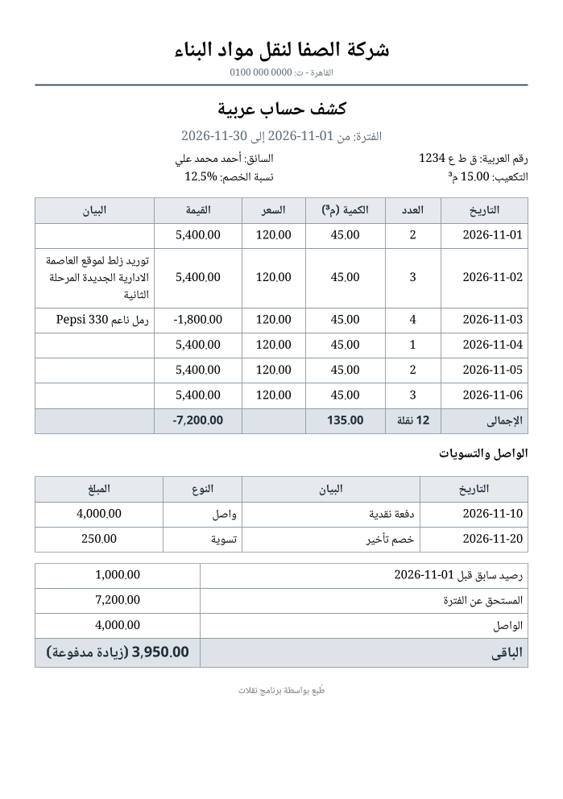
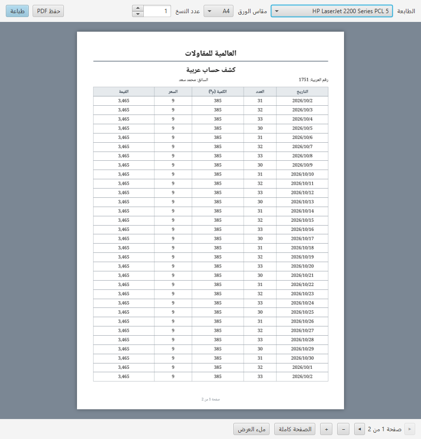

# Smart Report Plugin

       

**English** | [العربية](README.ar.md)

A Java library for reports and printing, added to any project as a dependency:

- **Print-ready Arabic PDF documents** on A4 and A5 (portrait and landscape): letterhead, title, fields, several tables with a totals row, a summary, page numbers, a QR code, a barcode — and direct output to a printer. Apache PDFBox (and ZXing core to encode the QR code and the barcode).
- **A ready JavaFX preview window**: the pages as they will print, a choice of printer, paper and copies, print and save as PDF — or print straight to the printer last chosen, with no window.
- **A generic PDF or Excel report from a `List<POJO>`**, with no template.
- **JasperReports** (visually designed `.jrxml`/`.jasper` templates): export to PDF, XLSX, HTML or CSV.

<p align="center"></p>

## What's New

### 2.7.1

- 2.7.1 is 2.7.0 that JitPack can build; 2.7.0 itself cannot be downloaded. Everything below came with it.
- **New:** print a receipt straight on the printer the user last chose, without opening the preview each time (`printOrShow`), and Ctrl+P / Ctrl+S in the preview window. See [Preview](#preview-pdfpreview).
- **New:** the QR code of a ZATCA phase 2 simplified tax invoice (`ZatcaQr.phase2`). See [QR code](#qr-code-and-the-saudi-tax-invoice-qr).
- **New:** the amount in words for QAR, BHD, OMR and JOD, and in English. See [Amount in words](#amount-in-words-amountinwords).
- **Fixed:** Arabic no longer disappears from PDFs exported from Jasper templates; give Arabic text boxes about 1.7 times the font size in height. See [Arabic in the PDF](#arabic-in-the-pdf).
- **Changed:** the generic Excel report freezes a filtered header, keeps its title out of the column widths, and is much faster on large reports.

### 2.6.0

- **New:** a Code 128 barcode for a shipment, waybill, invoice or item number that a hand scanner reads. Vector bars with the code written under it, and it fits the 58 mm roll. See [Barcode](#barcode-code-128).
- **Fixed:** signature boxes no longer land alone on a new page: when they do not fit under the summary, the summary (and the amount in words under it) moves with them.

Details of each release are in [CHANGELOG.md](CHANGELOG.md).

## Modules

Each kind of report is its own Maven module, so a program that only prints PDFs does not carry POI or Jasper:

| Module | What is in it | What it brings |
|---|---|---|
| `smart-report-pdf` | `PdfDocument`, `PdfPrinter`, `PdfPages`, and the generic PDF report | PDFBox, ZXing core (QR code, barcode) |
| `smart-report-fx` | `PdfPreview`: the preview window | `smart-report-pdf`; and your program's own JavaFX (`provided`) |
| `smart-report-excel` | The generic Excel report | Apache POI |
| `smart-report-jasper` | Jasper template reports | JasperReports |
| `smart-report-api` | `ReportService`, `ReportRequest`, `AmountInWords` and `ZatcaQr` — comes along with any module above | slf4j-api only |

## Installation

The library is served by [JitPack](https://jitpack.io) straight from the repository's tags:

```xml
<repositories>
    <repository>
        <id>jitpack.io</id>
        <url>https://jitpack.io</url>
    </repository>
</repositories>

<dependency>
    <groupId>com.github.MohamedSalah-13.smart-report-plugin</groupId>
    <artifactId>smart-report-pdf</artifactId>
    <version>v2.7.1</version>
</dependency>
```

Change `artifactId` to `smart-report-fx`, `smart-report-excel` or `smart-report-jasper` for what you need.
Built with Java 21. The `smart-report-fx` module exists from `v2.1.0`.

> The library uses `slf4j-api` only (no implementation), so to see its logs add a backend of your choice
> (logback, slf4j-simple, ...) to your project.

## PDF document (`PdfDocument`)

The document is built part by part, in the order the parts will appear:

```java
import com.smart.report.pdf.*;

PdfDocument document = PdfDocument.rtl(Paper.A5)            // or Paper.A4, or Paper.A4.landscape()
        .letterhead("شركة الصفا لنقل مواد البناء", "القاهرة - ت: 0100 000 0000")
        .title("كشف حساب عربية")
        .subtitle("الفترة: من 2026-11-01 إلى 2026-11-30")
        .field("رقم العربية", "ق ط ع 1234").field("السائق", "أحمد محمد علي")
        .table(t -> t
                .column("التاريخ", 22).column("العدد", 14, Align.CENTER).column("القيمة", 26, Align.CENTER)
                .rows(movements, m -> new String[]{date(m), trips(m), amount(m)})
                .totals("الإجمالى", "12 نقلة", "-7,200.00"))
        .heading("الواصل والتسويات")
        .table(payments)
        .summary("المستحق عن الفترة", "7,200.00")
        .summary("الواصل", "4,000.00")
        .summaryTotal("الباقى", "3,200.00")
        .footer("شكرًا لتعاملكم")
        .signatures("المستلم", "المحاسب", "الختم");          // signature boxes, kept with the summary above

document.save(Path.of("statement.pdf"));     // a file
byte[] pdf = document.toBytes();             // or bytes
```

- `PdfDocument.rtl(...)` for Arabic and `PdfDocument.ltr(...)` for English. The direction decides where the first column sits and how text is aligned.
- Columns and cells are written **in logical order**; the library is what puts the first column on the right in an Arabic page.
- A column's number (22, 14, 26) is its weight in the table's width, and no column goes below the width of its longest word.
- Text longer than its column **wraps** over several lines, the table header repeats on every page, and pages are numbered ("Page 2 of 3") once the document runs over one page.
- A row taller than a whole page continues on the next page, and so does a field whose value is taller than a page.
  A table header taller than a third of the page is drawn once instead of on every page.
- Negative numbers, dates, percentages and phone numbers read as they were written inside an Arabic sentence.

### Amount in words (`AmountInWords`)

The total written out in Arabic, as on an invoice or a receipt:

```java
import com.smart.report.util.AmountInWords;

document.text(AmountInWords.arabic(new BigDecimal("7200"), AmountInWords.Currency.EGP));
// فقط سبعة آلاف ومائتا جنيه لا غير

AmountInWords.arabic(new BigDecimal("1234.50"), AmountInWords.Currency.EGP);
// فقط ألف ومائتان وأربعة وثلاثون جنيهًا وخمسون قرشًا لا غير
AmountInWords.arabicWords(new BigDecimal("0.13"), AmountInWords.Currency.SAR);   // without «فقط ... لا غير»
// ثلاث عشرة هللةً

// In English, for a bilingual invoice:
AmountInWords.english(new BigDecimal("7200"), AmountInWords.EnglishCurrency.EGP);
// Seven thousand two hundred Egyptian pounds only
AmountInWords.english(new BigDecimal("7200.50"), AmountInWords.EnglishCurrency.EGP);
// Seven thousand two hundred Egyptian pounds and fifty piastres only
```

- The counted noun follows the number: `جنيه واحد`, `جنيهان`, `ثلاثة جنيهات`, `أحد عشر جنيهًا`, `مائة جنيه`, `مائتا جنيه`, `ألفا جنيه`.
- Numbers agree with the noun's gender: `ثلاثة جنيهات` but `ثلاث هللات`, and the Omani baisa is feminine too:
  `ثلاث بيسات`, `إحدى عشرة بيسةً`.
- Ready currencies: `EGP`, `SAR`, `AED`, `KWD`, `USD`, `QAR`, `BHD`, `OMR` and `JOD`. The fraction digits follow
  ISO 4217: 3 for the Kuwaiti, Bahraini and Jordanian dinar (fils) and the Omani rial (baisa), 2 for the others.
  Any other is a `new Currency(...)` with its noun forms.
- English: `english(...)` (with «only») and `englishWords(...)` take an `EnglishCurrency` with the same codes. The
  numbers are written as on invoices and cheques (`two hundred fifty`, `thirty-four`), with «and» only before the
  fraction. Any other currency is `new EnglishCurrency("Libyan dinar", "Libyan dinars", "dirham", "dirhams", 3)`.
- The amount is rounded to the currency's digits (half up). Negative amounts and amounts of a trillion or more are rejected.
- It lives in `smart-report-api`, so a Jasper or Excel report can use it too (as a parameter, for example).

### On every page

```java
document.letterheadOnEveryPage(true)                              // the letterhead (and logo) on top of every page
        .pageFooter("صادر من نظام نقلات - ت: 0100 000 0000");      // a small line at the bottom of every page
```

- `letterheadOnEveryPage(true)`: for long statements; a table that continues on a new page has its header under the letterhead.
- `pageFooter(text)`: above the page number on every page, including a single page. `footer(text)` is different:
  a closing sentence drawn once after the last part.
- `signatures(...)`: the boxes stay together, and stay with the summary before them (and any text between, such as
  the amount in words): when they do not fit under it, the summary moves to the next page with them. If that
  group cannot move, at least the last line of the text before the boxes goes with them.

### Thermal receipts (80 mm and 58 mm)

```java
PdfDocument receipt = PdfDocument.rtl(Paper.ROLL_80)          // or Paper.ROLL_58
        .letterhead("سوبر ماركت الهدى", "ت: 0100 000 0000")
        .table(items)
        .summaryTotal("الإجمالى", "85.00")
        .footer("شكرًا لزيارتكم");
```

- A receipt is **one page as long as its content**, not an A4 sheet: the roll is cut where the text ends.
- A smaller font and narrow margins are chosen for the roll. `PdfPrinter` asks the printer for no paper size, so it
  uses its own roll.
- `Paper.parse("80mm")` and the preview window know the rolls too. The preview opens a receipt at a readable size
  (as wide as the window allows, up to twice its size) instead of fitting the whole length into the window.

### QR code (and the Saudi tax invoice QR)

```java
document.qrCode("https://example.com/invoices/2026-0042");   // 30 mm, centred
document.qrCode(invoiceNumber, 25, Align.START);              // 25 mm, at the start of the line (right in Arabic)
```

The QR code a simplified tax invoice carries in Saudi Arabia (ZATCA e-invoicing, phase 1; phase 2 below): the
seller's name, VAT number, the time, the total with VAT and the VAT, encoded as ZATCA specifies:

```java
import com.smart.report.util.ZatcaQr;

String qr = ZatcaQr.payload("مؤسسة الهدى للتجارة", "310122393500003",
        LocalDateTime.now().atZone(ZoneId.of("Asia/Riyadh")).toInstant(),
        new BigDecimal("1150.00"), new BigDecimal("150.00"));

PdfDocument receipt = PdfDocument.rtl(Paper.ROLL_80)
        .letterhead("مؤسسة الهدى للتجارة", "الرقم الضريبي 310122393500003")
        .title("فاتورة ضريبية مبسطة")
        .table(items)
        .summary("ضريبة القيمة المضافة 15%", "150.00")
        .summaryTotal("الإجمالى شامل الضريبة", "1,150.00")
        .qrCode(qr);
```

- Drawn as vector squares, not an image, so it stays sharp on any printer. A quiet zone of 4 modules is left
  around it, and it is never split across two pages.
- The size is the side of the code in millimetres. On a narrow roll a code too wide for the line shrinks to fit,
  and the receipt is still cut right under it.
- `Align.START` puts it at the start of the line (right in an Arabic document), `Align.END` at the end, and
  `Align.CENTER` (the default) in the middle. Arabic text is encoded as UTF-8.
- `ZatcaQr.payload` returns the Base64 of the TLV fields (tags 1 to 5, each value's length in UTF-8 bytes, so an
  Arabic name counts its bytes, not its letters). The time is written in UTC and the amounts with two decimals; a
  VAT number that is not 15 digits beginning and ending with 3 is rejected. It lives in `smart-report-api` and
  needs no library.
- The code is encoded by [ZXing](https://github.com/zxing/zxing) core (Apache License 2.0, no dependencies of its
  own), which `smart-report-pdf` brings.

**Phase 2 (integration).** A simplified tax invoice (and its credit and debit notes) adds four values that come from
signing it: the invoice hash, the ECDSA signature, the public key, and ZATCA's signature of the stamp certificate.
`ZatcaQr` does not sign anything: the values come from the program's signing code or ZATCA's SDK.

```java
String qr = ZatcaQr.phase2("مؤسسة الهدى للتجارة", "310122393500003", issued,
                new BigDecimal("1150.00"), new BigDecimal("150.00"))
        .invoiceHash(digestValue)        // ds:DigestValue of the signed invoice (Base64)
        .signature(signatureValue)       // ds:SignatureValue (Base64)
        .certificate(certificate)        // the device's stamp certificate (CSID) as an X509Certificate
        .payload();

receipt.qrCode(qr, 45, Align.CENTER);    // a phase 2 code is denser: give it 45 mm (see below)
```

- Tags 6 to 9 are written as in the worked example of ZATCA's
  [E-invoicing Detailed Technical Guidelines](https://zatca.gov.sa/en/E-Invoicing/Introduction/Guidelines/Documents/E-invoicing-Detailed-Technical-Guideline.pdf)
  (section 6.2): the hash and the signature as their Base64 text, the public key and the certificate's signature as
  DER bytes. Without an `X509Certificate`, `publicKey(byte[])` and `certificateSignature(byte[])` take those bytes.
- The values must match the signed XML: the same seller name, VAT number, amounts and issue time.
- A value in the wrong form (a hash in hex, a signature that is not Base64 DER) or a missing one fails at once, and
  a code longer than ZATCA's 700 characters is rejected (a very long seller name is the usual cause).
- A standard tax invoice (B2B) is stamped by ZATCA at clearance and comes back with its QR code: print that one as
  it is.
- **Size.** A phase 2 code is about 90 to 100 modules wide (QR version 18 to 21), against about 40 for phase 1. At
  the default 30 mm each module is only about 0.3 mm, 2 to 3 dots of a 203 dpi thermal printer, which is marginal
  for a scanner. At 45 mm a module is 0.45 to 0.5 mm (about 4 dots), and the code with its quiet zone (about 49 mm)
  still fits the 58 mm roll (52 mm of line) as well as the 80 mm one.

### Barcode (Code 128)

For a shipment, waybill, invoice or item number, read by a hand scanner:

```java
document.barcode("SHP-2026-0042");                    // bars 12 mm tall, centred, the code written under them
document.barcode(waybillNumber, 15, Align.START);     // 15 mm, at the start of the line (right in Arabic)
```

- Drawn as vector bars, not an image, with the code written under them left to right as it is, even on an Arabic
  page. A quiet zone of 10 bars is left on each side, and the bars and the code are never split across two pages.
- The narrowest bar is 0.33 mm (about 3 dots on a 203 dpi thermal printer). A code too wide for the line gets
  narrower bars, down to 0.25 mm; a code that would need thinner bars than that fails with a `ReportException`
  that names it, instead of printing bars no scanner reads. On a 58 mm roll that is about 15 characters; runs of
  digits are packed two to a bar pattern, so mostly-numeric codes are shorter.
- Code 128 holds English letters, digits and signs only: Arabic text, accented letters or tabs are rejected with an
  `IllegalArgumentException` when the barcode is added.

### Style (`PdfStyle`)

With nothing set, the style follows the paper (`PdfStyle.forPaper`): a smaller font and margins on A5. To change it:

```java
document.style(PdfStyle.forPaper(Paper.A4)
        .withHeaderColors(0x2C3E50, 0xFFFFFF)   // a dark table header with white text
        .withStripes(true)                      // alternate rows shaded
        .withMargin(28f));

document.style(PdfStyle.forPaper(Paper.A5).inkSaver());   // no fills at all: rules instead of backgrounds
```

### Printing (`PdfPrinter`)

```java
List<String> printers = PdfPrinter.printerNames();          // the printers set up on this computer
Optional<String> preferred = PdfPrinter.defaultPrinter();

PdfPrinter.print(document, printerName, 1);                 // the document on its own paper, one copy
PdfPrinter.print(pdfBytes, printerName, Paper.A5, 2);       // or a ready PDF
```

The printer is asked for the document's paper (A4 or A5) and pages are sent at their actual size. An empty
`printerName` means the default printer. Printing takes its time, so call it off the UI thread. If the
printer is not on the computer, a `ReportException` names it and lists the printers that are available.

### Preview (`PdfPreview`)

The `smart-report-fx` module has a preview window for any JavaFX program:

<p align="center"></p>

```java
import com.smart.report.fx.PdfPreview;

PdfPreview.of(paper -> StatementPdf.document(statement, companyName, paper))
        .papers(Paper.A4, Paper.A5)       // one paper = no paper choice in the window
        .title("كشف حساب عربية 1751")
        .fileName("كشف 1751")              // the name suggested by "Save PDF"
        .rightToLeft(true)                 // an Arabic window; false = English
        .remember("statement")             // the last printer and paper, per kind of document
        .stylesheet(appStylesheetUrl)      // optional: your program's CSS
        .show(ownerWindow);

PdfPreview.of(document).show(ownerWindow);   // or a ready document on its own paper
```

- The window shows the pages with the same drawing the printer receives, and does not block the program.
- When the user changes the paper, the document is built again for the new paper.
- The function that builds the document is called **off the UI thread**: read your data before it and touch no JavaFX node inside it.
- The window's wording is Arabic or English by `rightToLeft`, and `texts(PreviewTexts)` replaces it with your program's terms.
- Keys: Ctrl+P prints (only when the Print button can), Ctrl+S saves, PageUp/PageDown turn the pages and Esc closes the window. On a Mac it is ⌘P and ⌘S.
- To draw pages as images yourself (a custom preview, a thumbnail): `PdfPages.open(pdf).render(pageIndex, scale)` in `smart-report-pdf`.

#### Print straight away (`printOrShow`)

A cashier should not have to open the preview for every receipt. With `remember(key)`, `printOrShow` sends
the document to the printer the user last printed on from the window, and opens the window only when there
is no such printer yet:

```java
PdfPreview.of(paper -> ReceiptPdf.document(sale, shop, paper))
        .papers(Paper.ROLL_80)
        .remember("receipt")
        .printOrShow(ownerWindow)
        .thenAccept(outcome -> {
            switch (outcome) {
                case PrintOutcome.Sent sent -> status.setText("Sent to " + sent.printer());
                case PrintOutcome.Failed failed -> showError("The receipt was not printed", failed.reason());
                case PrintOutcome.Shown shown -> { }   // no printer remembered yet: the window is open
            }
        });
```

- The first time, or when the remembered printer is no longer on the computer, the preview window opens. The
  printer the user prints on from it is remembered, and from then on the document goes straight to it.
- It prints one copy, on the paper the window would open on: the one given to `paper(...)`, else the last
  one printed, else the first of `papers(...)`.
- It returns at once: the printers are asked, and the document is built and printed, off the UI thread. The
  future completes on the JavaFX thread, so its handler may update your nodes.
- When the remembered printer is there but printing fails (the document could not be built, or the printer
  refused the job), the outcome is `Failed` and **no window opens**: a window popping up by itself in the
  middle of the next sale would take the keyboard from the till. `failed.reason()` is for the log; to let the
  user choose another printer, call `show(ownerWindow)` from that branch.
- To change the printer later, open the window with `show(ownerWindow)` and print once from it.

### Font

The library bundles the **Noto Naskh Arabic** font (regular and bold), so the output is the same on every
computer with no setup. To change it, in this order:

1. The `smart.report.pdf.font` property (and optionally `smart.report.pdf.font.bold`) — the path of a `.ttf` file.
2. A classpath resource named `fonts/report-font.ttf` (and `fonts/report-font-bold.ttf`).

A character the chosen font lacks is tried in a system font (Arial and others), and as a last resort is
printed as `?` with a warning in the log.

> Arabic is prepared automatically before drawing: letters are joined and ordered right to left, with the
> lam-alef ligature, and letters such as ڤ, چ, گ, پ, ک and ی join as well. This is the work of `ArabicTextShaper`, and it needs no extra dependency (no ICU4J or
> anything else). Diacritics (tashkeel) are centred over their letters approximately — PDFBox does not apply
> the font's GPOS tables.

## Generic PDF or Excel (no template)

The same `ReportRequest` works for both; only `ReportType` changes:

```java
import com.smart.report.*;

ReportRequest<Employee> request = ReportRequest.<Employee>builder()
        .title("تقرير الموظفين")
        .data(employees)
        .addColumn("id", "الرقم")
        .addColumn("name", "الاسم")
        .addColumn("salary", "الراتب")
        .build();

byte[] pdf = ReportService.generate(ReportType.PDF, request);     // needs smart-report-pdf
byte[] xlsx = ReportService.generate(ReportType.EXCEL, request);  // needs smart-report-excel

ReportService.generateToFile(ReportType.PDF, request, Path.of("employees.pdf"));
```

Each column's name (`addColumn("id", ...)`) is read from the object by reflection: `getId()`, `isId()`, `id()`
(record components), and finally the field itself.

A column can carry its own options for the PDF report — a format pattern, an alignment and a width weight:

```java
.addColumn(ColumnDefinition.of("amount", "المبلغ").withFormat("#,##0.00").withAlign(Alignment.END).withWeight(2))
.addColumn(ColumnDefinition.of("date", "التاريخ").withFormat("d MMMM yyyy"))   // 26 نوفمبر 2026
```

- `withFormat`: a `DecimalFormat` pattern for numbers (rounded half up) or a `DateTimeFormatter` pattern for dates.
  Month and day names follow the report's language; digits stay Latin. A pattern that does not fit a value
  (`HH:mm` on a date with no time) fails with a `ReportException` naming the column.
- `withAlign`: `START`, `CENTER` or `END`, relative to the report's direction. Without it, a column of numbers goes
  to the end of the line and anything else to the start.
- `withWeight`: the column's share of the table width (2 = twice a normal column).

The Excel report applies the format (turned into an Excel format, so a number stays a number and a date a date)
and the alignment. It ignores the weight: its columns are sized to their content. A date pattern letter Excel has no
format for (a time zone, `z`), or an hour Excel would show differently (`hh` without `a`), fails with a
`ReportException` naming the column.

Both reports run right to left if the title or any column header contains Arabic (in Excel the sheet itself
runs right to left). The PDF report is on portrait A4. To change that:

```java
.parameter(PdfReportProvider.PAPER, "A5-landscape")        // or a Paper object
.parameter(PdfReportProvider.RIGHT_TO_LEFT, true)
.parameter(ExcelReportProvider.RIGHT_TO_LEFT, true)       // the direction of the Excel sheet
```

In the PDF, numbers get thousands separators (`1,234,567.5`, `1,200.50`), dates are written `2026-11-26` and
`2026-11-26 10:30:00`, and a column holding only numbers is aligned to the end of the line so the numbers line up.

In Excel, numbers, booleans and dates are written with their own types, not as text. The header row stays in view
as you scroll and has filter buttons, so the sheet can be sorted and filtered straight away. Each column is as wide as
its header and content, up to Excel's limit of 255 characters; the title does not count. To keep a large report fast,
text is measured in the first 500 rows only: a longer text further down is cut at the column's edge (the cell still
holds all of it). Numbers and dates fit in every row, so none shows as `####`.

If you ask for a type whose module is not on the classpath, a `ReportException` tells you which dependency
to add.

## JasperReports (a visually designed template)

```java
import com.smart.report.JasperExportFormat;

ReportRequest<Employee> request = ReportRequest.<Employee>builder()
        .data(employees)
        .template("reports/employee.jrxml") // a file on disk or a classpath resource
        .parameter("ReportTitle", "تقرير الموظفين")
        .exportFormat(JasperExportFormat.PDF) // or XLSX / HTML / CSV
        .build();

byte[] pdf = ReportService.generate(ReportType.JASPER, request);  // needs smart-report-jasper
```

`request.data()` is turned into a `JRBeanCollectionDataSource` automatically, and `request.parameters()` are
passed as report parameters (`$P{...}`). Compiled templates are cached and reused.

### Arabic in the PDF

A PDF draws every letter from a font embedded in the file. The font JasperReports uses when a template names none
(`SansSerif`, drawn as Helvetica) has no Arabic, so Arabic text used to vanish from the PDF without an error.
`smart-report-jasper` carries **Noto Naskh Arabic** (regular and bold, the font `smart-report-pdf` uses) as a
JasperReports font extension, and a template chooses its font like this:

- **A template that names no font** (or names `SansSerif`) needs nothing. Its Arabic letters, Arabic digits and
  Arabic punctuation (، ؛ ؟) are drawn with Noto Naskh Arabic, bold ones with the bold file, right to left. Every
  other character keeps JasperReports' default font, so a report without Arabic comes out exactly as before.
- **A template that names a font** keeps it, and so does a program that changed JasperReports' default font
  (`net.sf.jasperreports.default.font.name`). If that font has no Arabic, set `fontName="Noto Naskh Arabic"` on the
  fields that show Arabic: all of their text is then drawn with it, Latin included, and bold is drawn thickened.
- **Give Arabic room.** A line of Noto Naskh is about 1.7 times the font size high (room for the vowel marks): a
  10 pt field needs 18 pt, an 18 pt title 31 pt. JasperReports prints nothing of a text whose first line does not
  fit its box, so `ReportService` fills with `ArabicTextMeasurerFactory`, which changes only that case. In a box
  that does not grow (`textAdjust` `CutText`, the default), Arabic text with no line that fits gets its first line
  drawn anyway when the box is at least about 1.15 times the font size (a box that holds the same line in Latin):
  the box keeps its size, and in a box shorter than about 1.5 times the font size the tails of letters such as
  ي and ج can reach past its bottom edge. A text that still prints nothing, in any language, is logged as a
  warning naming the report and the field; so is a line drawn past its box. Text that fits, text without Arabic,
  `StretchHeight` and `ScaleFont` fields come out exactly as before. A program that fills with `JasperFillManager`
  itself can set `net.sf.jasperreports.text.measurer.factory=com.smart.report.jasper.ArabicTextMeasurerFactory`.

The extension is registered by `jasperreports_extension.properties` at the root of the jar. A fat jar has to merge
that file from all jars rather than keep one (maven-shade-plugin: `AppendingTransformer`). With
`jasperreports-fonts` (DejaVu) on the classpath, its own `SansSerif` entry wins and the default font has no Arabic
again: name `DejaVu Sans` or `Noto Naskh Arabic` in the template.

## With Claude Code

The `claude-skill/pdf-print` folder holds a skill that wires the library into any existing or new project:
the dependency, building the document from the program's data, the preview window, and the tests. Copy it
to `~/.claude/skills/` and then tell Claude: "add PDF printing for the invoice" or "add a preview before
printing".

## Upgrading from 1.0

- The library is now modules: replace `smart-report-plugin` with the module you use (`smart-report-pdf` / `-excel` / `-jasper`).
- `JasperExportFormat` moved from `com.smart.report.jasper` to `com.smart.report`.
- If you wrote your own `ReportProvider`: it gained `type()`, and it is registered in `META-INF/services/com.smart.report.ReportProvider`.
- The generic PDF report now wraps long text instead of cutting it with `...`, and an Arabic report's table runs from the right.

## Tests and build

```bash
./mvnw test       # every module
./mvnw verify     # the tests, and each module's API checked against the last release
./mvnw install    # builds the modules and installs them in the local repository
```

`./mvnw` (`mvnw.cmd` in a Windows command prompt) downloads and runs Maven 3.9.16, the Maven JitPack builds the
library with. How a release is made, and what to do when JitPack cannot build one: [RELEASING.md](RELEASING.md).

The PDF tests read the **positions** of the drawn glyphs, not only the extracted text: direction faults
(a column on the wrong side, a total under another column, the end of a sentence on the first line) do not
show in the text.

## Licenses

The project is licensed under the [MIT License](LICENSE). The bundled Noto Naskh Arabic font is licensed under the
[SIL Open Font License 1.1](smart-report-pdf/src/main/resources/com/smart/report/pdf/fonts/OFL.txt).
